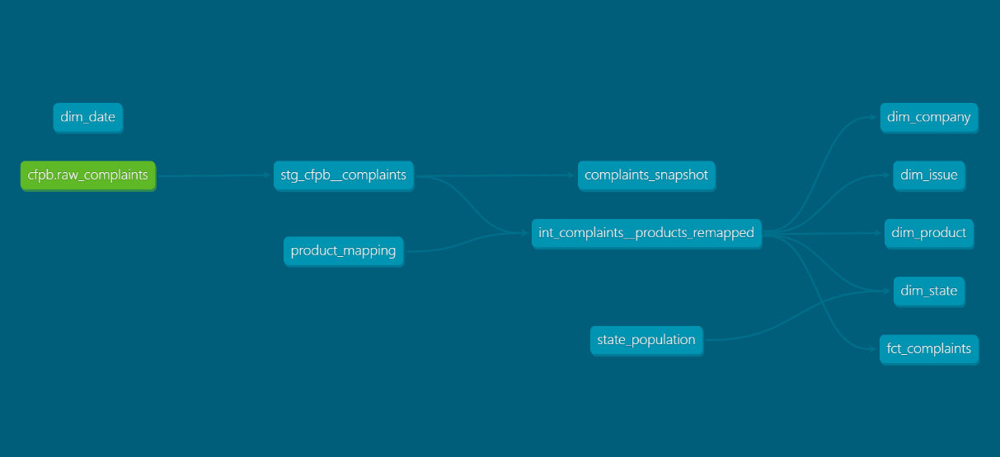

# CFPB consumer complaints: a dbt project

This project rebuilds the data model behind my CFPB complaints Power BI report as a tested dbt pipeline. It turns about 1.4 million consumer complaints from the Consumer Financial Protection Bureau into a star schema that Power BI reads directly.

**Tools:** dbt Core 1.12, DuckDB, dbt_utils, SQLFluff, Git, Power BI

## The problem it solves

In August 2023 the CFPB retired its "Credit card or prepaid card" product and split it into "Credit card" and "Prepaid card." Without a fix, credit card complaints look like they started in late 2023. A mapping seed sends the old category's credit card rows to the new name, so the trend runs continuously from January 2023. Prepaid cards are left out because they aren't one of the four products this report covers.

## How it's built

- **Staging** (`stg_cfpb__complaints`): renames columns, sets data types, turns blank text into nulls, and removes duplicate complaint IDs.
- **Intermediate** (`int_complaints__products_remapped`): applies the product fix using the `product_mapping` seed.
- **Marts:** `fct_complaints` (one row per complaint, built incrementally with a 30-day lookback) and five dimensions: product, issue, company, state (with population from a seed), and date (built with `dbt_utils.date_spine`).
- **Snapshot** (`complaints_snapshot`): records each time a company's response changes, for example from "In progress" to "Closed with explanation."

## Testing and quality

Every `dbt build` tests the models as it builds them. The tests cover unique and not-null keys, the list of allowed products, and relationships from the fact table to every dimension. If a test fails, the models that depend on it are skipped, so bad data never reaches the report. SQLFluff checks the SQL style.

## Run it yourself

1. Install Python, then run `pip install dbt-duckdb`.
2. Download complaints as CSV files from the CFPB complaint database (https://www.consumerfinance.gov/data-research/consumer-complaints/) into `C:/dbt/cfpb_data`, or change the path in `models/staging/_sources.yml`.
3. Run `dbt deps`, then `dbt build`.
4. Run `dbt run-operation export_marts --target prod` to write the marts as Parquet files for Power BI.